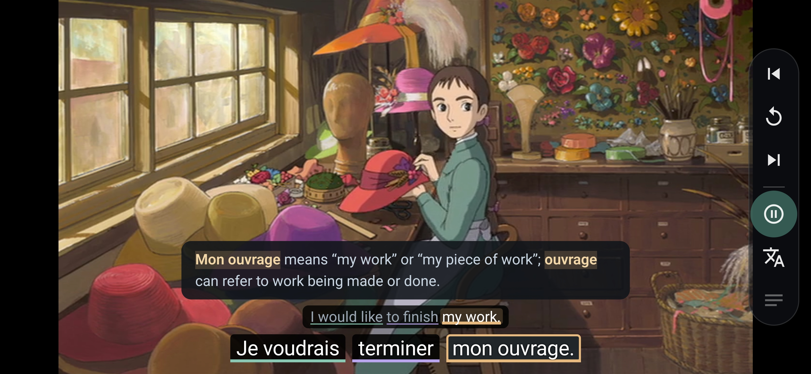
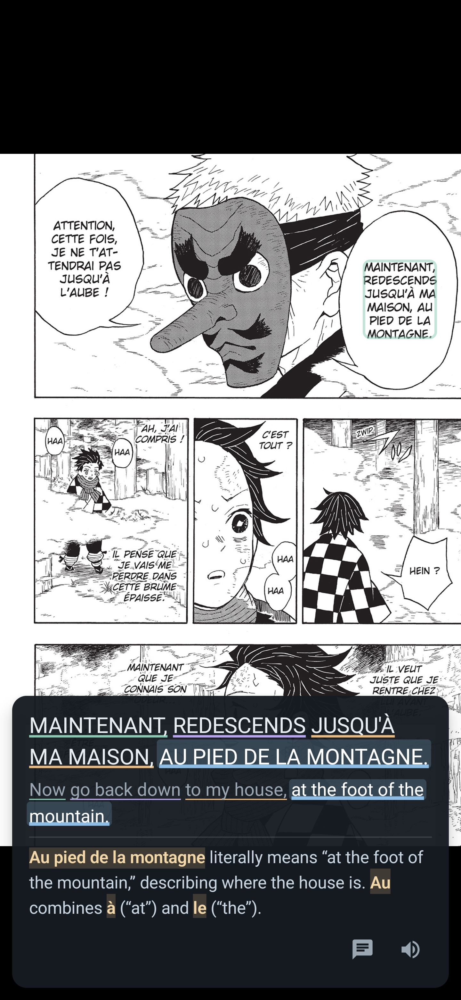

# petites roues

Un vélo avec des petites roues

A bike with training wheels - I know it's not funny if you have to explain the joke but this is a project for language learning beginners!



petites roues is a self hosted app for anyone who wants help watching/reading in another language. It has browser and Android app versions.

## In short 

It's like Language Reactor with the auto-pause and translations. But with deeper explanations and sentences broken up into manageable chunks. 

And it applies a similar methodology to reading too. Currently only on comics/manga but I plan to apply it to other text media soon.



## Motivation

I've been learning French for a while, and iterating on ideas to make consuming French media easier for almost as long.

I have found it seems to be a generally accepted practice that it's good to hear/read what you dont know to get used to not knowing and learning it later.

But as a software developer I was wanting a faster feedback loop. Encounter an unfamiliar phrase, get its contextual meaning and explanation, move on.

My first go was a browser extension for reading manga where I could highlight speech bubbles and submit a screenshot of the text to Claude to translate and explain the text.

It worked pretty well but was rather clunky. And if I wanted to read the manga again, the data was in no format to be re-read.

My next go was a video player called 'Sacre Bleu', inspired by Language Reactor but providing more than a direct translation. And this time I decided it would be an application with a data format rather than a crude layer on top of a coding agent.

Petites roues builds on top of that player, extends the model and applies it to other media. 

## Principles

### Portable annotations

A lot of work goes into the creation of the study documents, so they are designed to be version controllable and as easy to share as running a git clone.

### Contextual explanations

A direct translation is useful, but I want more than that. Grammar, idioms etc

### Minimal noise

I want to request help, not have it forced upon me.

### Iteration is built into the model

Stable cue identities and annotations that can be corrected.

Both people and AIs make mistakes, the study documents are intended to be interated on and improved, so that is built into the model.

## Project structure

The project consists of three parts. 

### Document Model

The model is designed to facilite providing the contextual information to the user, and to break down sentances into phrases that are hopefully more digestable to a beginner. 

### Study Document Creation

I am currently doing this quite simply with Openrouter. 

1. Vextral transcribes videos or Terra draws boxes on comics and extracts text.

2. Luna does a first pass at annotating everything.

3. Opus reviews and refines Lunas output.

Costs about $1 per hour of video. 

A later project might be to turn it into an agentic pipeline, but for now this is working well.

### Content Repositories

The study documents are simply stored in git repositories to be as portable as possible.
A repository can also hold general quizzes not tied to a title: Markdown prompts in a
`quizzes/` folder at its root, offered by the library's Quiz me (lightbulb) and handed to a
chat app. See [agents/workflows/write-quiz.md](agents/workflows/write-quiz.md). Study notes,
Markdown pages in a `notes/` folder at its root, are read in the library's Notes; see
[agents/workflows/write-notes.md](agents/workflows/write-notes.md).

### Player

#### Java Server 

As much logic as possible is contained in the java server because that is what I am most comfortable with. 

There is document editing functionality in the server. But to prevent an agent and the server fighting over document writes, the server stores user updates and makes them available over an API. Then an agent picks up a batch of changes, updates the documents and notifies the server that the changes have been applied. 

And to prevent the server from serving stale content, the read model is to read the document and pending updates.

#### React UI

Kept as simple as possible, effectively just making the backend functionality usable.

#### Android

An offline phone version of the player and comic reader, without edit mode. It reads the same study documents from a folder synced to the phone, using the same Java document model. See [BUILD.md](docs/BUILD.md#android-app).

## Quick Start

The quickest way to run it is via the browser. It's a local desktop web application. Requires Java 25 and
Node.js 24.

From the repository root, build the Java modules and start the API:

```bash
./java/mvnw -f java/pom.xml verify
mkdir -p content
java -jar java/server/target/petites-roues-server-0.1.0-SNAPSHOT.jar
```

In a second terminal, start the Node development server:

```bash
cd web
npm ci
npm run dev
```

Open [petites roues](http://127.0.0.1:8875/) then use **Add repository** to select the example directory. A repository here is simply a content folder; Git is optional. Roughly:

```text
directory/
  structure/
    document.json
    video.mp4
```
