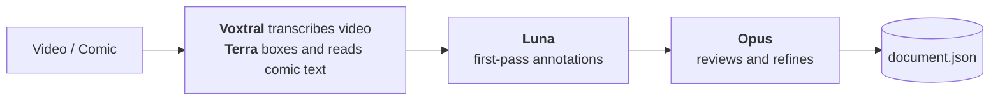
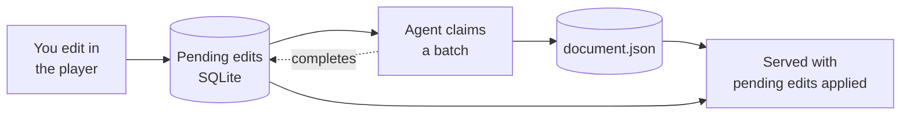

<div align="center">


# petites roues

***Un vélo avec des petites roues***

A bike with training wheels. I know it's not funny if you have to explain the joke, but this is a
project for language learning beginners!

[](LICENSE)


[In short](#in-short) · [Motivation](#motivation) · [Principles](#principles) ·
[How it works](#how-it-works) · [Quick start](#quick-start)

</div>

<br>

<p align="center">
  
</p>

petites roues is a self-hosted app for anyone who wants help watching or reading in another
language. It has browser and Android app versions.

## In short


It's like Language Reactor with the auto-pause and translations, but with deeper explanations and
sentences broken up into manageable chunks.

And it applies a similar methodology to reading too. Currently only on comics/manga, but I plan to
apply it to other text media soon.

- **Watch** with subtitles split into phrases, each with its translation and explanation
- **Read** comics and manga, opening a speech bubble for the same breakdown
- **Listen** to a line or a single phrase read aloud
- **Take it with you**: the Android app works offline from a synced folder

<br clear="right">

## Motivation

I've been learning French for a while, and iterating on ideas to make consuming French media
easier for almost as long.

It seems to be generally accepted that it's good to hear and read what you don't know, to get used
to not knowing and learn it later.

But as a software developer I wanted a faster feedback loop: encounter an unfamiliar phrase, get
its contextual meaning and explanation, move on.

My first go was a browser extension for reading manga, where I could highlight speech bubbles and
submit a screenshot of the text to Claude to translate and explain it. It worked pretty well but
was rather clunky, and if I wanted to read the manga again, the data was in no format to be re-read.

My next go was a video player called *Sacre Bleu*, inspired by Language Reactor but providing more
than a direct translation. This time I decided it would be an application with a data format,
rather than a crude layer on top of a coding agent.

petites roues builds on top of that player, extends the model and applies it to other media.

## Principles

| | |
|---|---|
| **Portable annotations** | A lot of work goes into creating the study documents, so they are designed to be version controllable and as easy to share as running a `git clone`. |
| **Contextual explanations** | A direct translation is useful, but I want more than that: grammar, idioms and so on. |
| **Minimal noise** | I want to request help, not have it forced upon me. |
| **Iteration is built into the model** | Both people and AIs make mistakes. Stable cue identities and correctable annotations mean study documents can be iterated on and improved. |

## How it works

The project consists of three parts: the document model, study document creation and the player.

### Document model

The model is designed to provide contextual information to the learner, and to break sentences
down into phrases that are hopefully more digestible for a beginner.

### Study document creation

I am currently doing this quite simply with OpenRouter:



It costs about **$1 per hour of video**. A later project might be to turn it into an agentic
pipeline, but for now this is working well.

### Content repositories

The study documents are simply stored in Git repositories to be as portable as possible.

A repository can also hold:

- **Quizzes** not tied to a title: Markdown prompts in a `quizzes/` folder at its root, offered by
  the library's *Quiz me* (lightbulb) and handed to a chat app. See
  [write-quiz.md](agents/workflows/write-quiz.md).
- **Study notes**: Markdown pages in a `notes/` folder at its root, read in the library's *Notes*.
  See [write-notes.md](agents/workflows/write-notes.md).

### Player

**Java server.** As much logic as possible lives in the Java server, because that is what I am
most comfortable with.

The server has document editing functionality, but to stop an agent and the server fighting over
document writes, the server stores user edits and makes them available over an API. An agent picks
up a batch of changes, updates the documents and tells the server they have been applied. To avoid
serving stale content, the server reads the document together with its pending edits.



**React UI.** Kept as simple as possible, effectively just making the backend functionality usable.

**Android.** An offline phone version of the player and comic reader, without edit mode. It reads
the same study documents from a folder synced to the phone, using the same Java document model.
See [BUILD.md](docs/BUILD.md#android-app).

## Quick start

The quickest way to run it is in the browser, as a local desktop web application.

> **Requires** Java 25 and Node.js 24.

**1.** From the repository root, build the Java modules and start the API:

```bash
./java/mvnw -f java/pom.xml verify
mkdir -p content
java -jar java/server/target/petites-roues-server-0.1.0-SNAPSHOT.jar
```

**2.** In a second terminal, start the Node development server:

```bash
cd web
npm ci
npm run dev
```

**3.** Open <http://127.0.0.1:8875/> and use **Add repository** to select the `example` directory.

A repository here is simply a content folder; Git is optional. Roughly:

```text
directory/
  structure/
    document.json
    video.mp4
```

<div align="center">
<br>
<sub>MIT licensed · made while learning French</sub>
</div>
