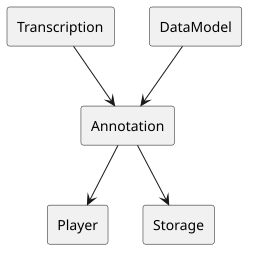
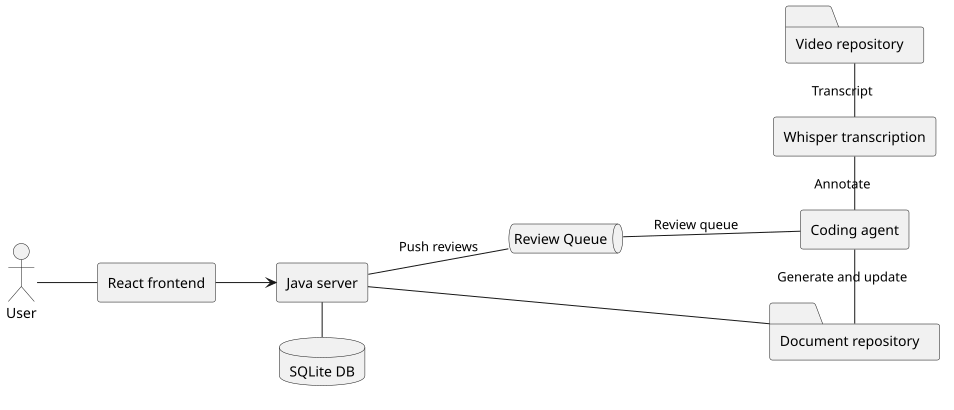
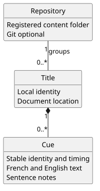
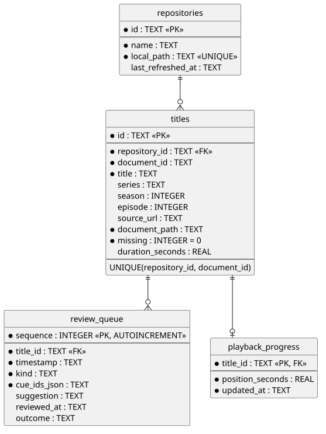

# Design

## 1. Problem Statement

I want to improve my French by consuming french content - a video player that provides more than a crude translation. 

## Decomposing the problem

### 1.1. Getting a usable transcript

The French seem to love dubs. So getting hold of French language content is easy enough. One common issue I found is that for French dubbed content, quite often the accompanying subtitles are of the original language audio so are different enough to be very difficult to work with. Other sources of content, such as YouTube, provide an auto transcription but quite often they don't or is just plain bad.

### 1.2. Learning more than the translation

I'm greedy so I want to learn as much as possible. 

```
George, si tu as envie de sauter dans les flaques de boue, tu dois mettre tes bottes en caoutchouc.
George, if you want to jump in muddy puddles, you must put on your rubber boots.
```

There are all sort of insights to draw from even a simple sentance like this. I want to be told about them so next time I can spot them for myself. 

- `avoir envie de + infinitive` - expresses wanting to do something
- `mettre` - here the verb "to put" is used to "put on"

So we need a data model with room for annotations.

### 1.3. Producing the annotations

Once we have a data model that can supply the data we want to the player, we need some way of populating the data.

### 1.4. Handling poor data

This particular data can be bad in all sorts of different ways. It shouldn't however be a blocker and we need to work around it.

- Missing subtitles
- Incorrect subtitles
- Poor timing boundaries
- Horrible line breaks

The system should be usable despite these difficulties. 

### 1.5. Iterating on the data

Once we have an annotated a transcript, and I've watched it and decided that some of the transcription was poor and used the correction utilities. We will need a way to update the study document.

### 1.6. Versioning the study documents

With the amount of work that goes into these study documents, it will be necessary not to lose them.

## 2. Reducing the problem 

I have had a tendency in the past to try to build everything, but it's important to pick your battles. The problems described above can be reduced considerably using open source tools and "outsourcing" some of the tasks. 

This particular problem can be split into domains. 



We will use the suite of tools supplied by Subtitle Edit for transcription. Which under the hood uses the speech-recognition model Whisper. 

Even if we didn't have access to coding agents, having a French beginner produce their own detailed study documents would not be what I would describe as hitting the ground running. Thankfully we do have coding agents, so I can detail in a prompt examples of the insights I want to extract and outsource this problem to them.

Given an agent is producing the study document, it would make sense for them to update them too. 

There is a lot of value in these study documents and given the role of creating and updating them has been outsourced there is no longer the requirement for complex machinery to update the document. The contract is simply files in and out, and git happens to do that very well! And with the added benefit that sharing git repos is very easy.

So the problem is reduced to a data model and a simple player. 

## 3. Designing a solution



The first iteration will be a simple React player backed by a Java service. The coding agent will be Codex, I will be prompting it to annotate the transcriptions myself to both avoid paying the API costs and reduce the complexity of concurrent writes to the document repository.

### 3.1. Backend Functionality

The backend will need functionality to:

- Browse the document repository
- Play videos with annotations
- Merge, split, add, remove and edit cues
- And also a nice quality of life feature of storing current video position

### 3.2. Domain Modelling



Most of the complexity is in the document model, see DOCUMENT-FORMAT.md. The supporting domain concepts are all relatively simple. 

#### 3.2.1. Repository

A Repository is a local content folder. The folder structure within the repository does not matter. And study documents located within it will be registered with the app.

#### 3.2.2. Title

For each study document found in a repository, a title is registered. 

#### 3.2.3. Cue

A transcribed title might have many cues. It is possible to register a title before it has been transcribed.

### 3.3. Schema Design



Here the domain model is interpreted into a database schema. 

Note from earlier that a title has many cues, but there is no Cues table in the schema. Cues live in the study document files described by DOCUMENT-FORMAT.md.

This initial solution will not use dedicated infrastructure for the queue. The same result can be achieved using a database table.

### 3.4. Review Workflow

To facilitate working with poor data, we have a review workflow to update cues. 

The operations a user can perform on a document are:

- Add cue
- Delete cue
- Edit Cue
- Edit Cue Timing
- Split

This is where the biggest trade off lies. 

### 3.5. Front End Design

The frontend will be kept as simple as possible by being effectively simply making available all of the backend functionality.

This simplicity will be achieved by maximising use of off the shelf components from the Mantine library.

### 3.6. Design Concerns

The document repository used to be written by both the agent and the Java server, which needed
rules about simultaneous editing and refreshing the player. Now only the agent writes it. The
server queues player edits as commands and serves each document as an accepted copy (the file as
last imported) plus those edits, and the agent writes them into the file in batches; completing
each batch imports the file ([review API](REVIEW-API.md)). The cost is
that unprocessed edits live only in SQLite until an agent runs.
