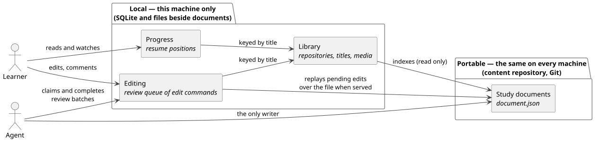
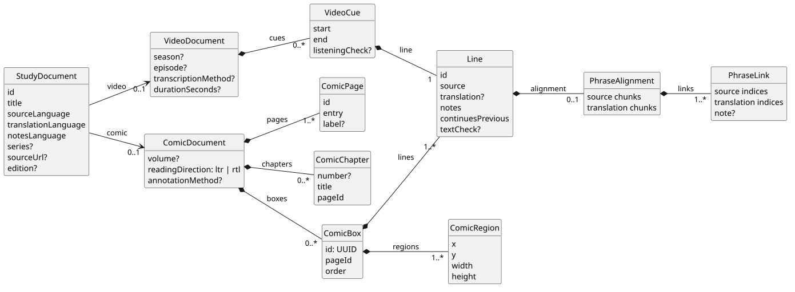
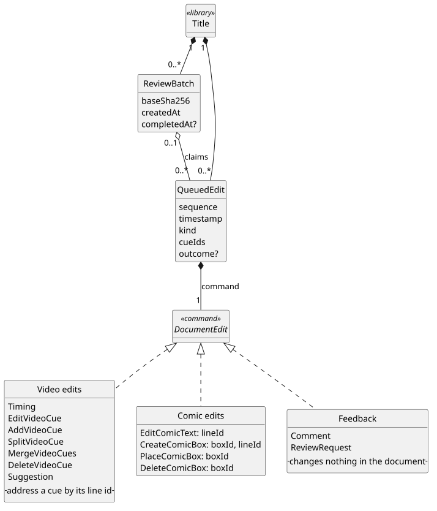
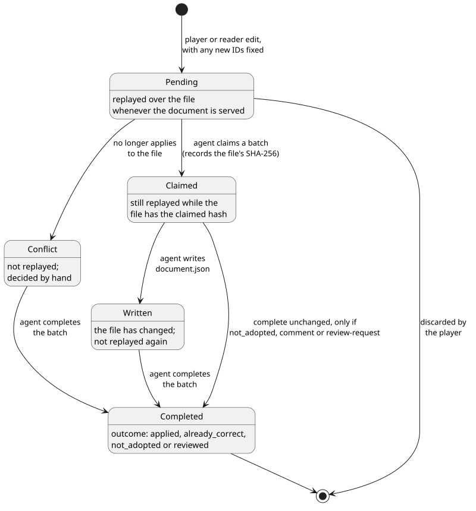
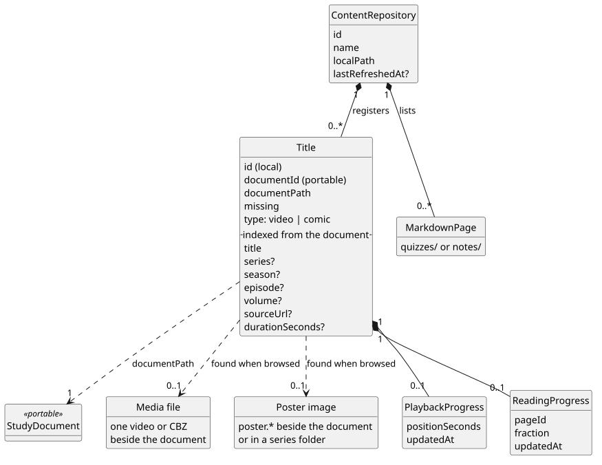
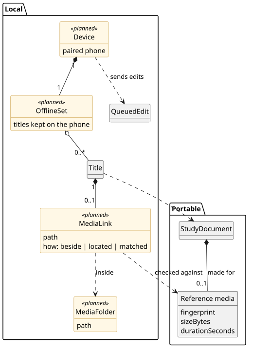

# Domain model

petites roues has three domains: **content**, **editing** and the **library**. They're
one model, split by a single boundary: what is **portable** (the same on every machine, shared
through a content repository) and what is **local** (this machine's paths, state and history).



| Domain | Portable or local | Where it's stored | Who writes it |
| --- | --- | --- | --- |
| Content | Portable | `document.json`, `quizzes/*.md` and `notes/*.md` in a content repository | Agents only |
| Editing | Local queue of commands that refer only to portable IDs | SQLite `review_queue`, `review_batches` | The app, from player and reader edits |
| Library | Local | SQLite `repositories`, `titles`, `media`, progress tables; posters found beside media | The app, on Add/Refresh |

Two rules hold the boundary:

- **Local state never enters a document.** Paths, progress, availability and queue history stay
  out of `document.json`, so a content repository can be shared and synced as-is.
- **The app never writes documents.** The library only reads them to index their metadata, and
  editing serves each document as the file plus its pending edits. Agents write the file, then
  close the edits.

## Study documents

The JSON format is specified in [DOCUMENT-FORMAT.md](DOCUMENT-FORMAT.md). It's defined by the
records in `app.petitesroues.model.document` and checked by `StudyDocumentValidator` in content-model.



- A `StudyDocument` is shared metadata plus exactly one body, a sealed `StudyBody` that is
  either a `VideoDocument` or a `ComicDocument`. The body is never null, so a document can't
  have both or neither, and code that depends on the kind switches over `body()`. In JSON the
  body sits under its kind, `"video"` or `"comic"`.
- A **line** is the unit of study: source text with its translation, notes and an optional
  phrase breakdown. A video cue holds one line. A comic box holds one or more lines in reading
  order; a box with several lines is a text block read a sentence at a time.
- A comic **page** holds its boxes in reading order: a box's page and order are where it sits,
  not fields of its own. **Chapters** are an index over the page sequence: each names its first
  page, so chapters can be added or corrected without moving pages.
- **Identity:** line IDs are unique within a document. Comic box IDs are UUIDs, unique across
  the comic, in a namespace separate from line IDs. Box operations (place, delete) address the box;
  text operations, comments and review requests address a line.
- A `PhraseAlignment` is bound to its line's wording only through its chunks, which must spell
  out the line's source and translation exactly. A line with no alignment needs a breakdown.

## Quizzes and study notes

General quizzes in `quizzes/` and study notes in `notes/` are portable Markdown
content, separate from annotated media documents. Both platforms use
`app.petitesroues.model.pages.MarkdownPage` in `content-model`, including the rule
that the first nonempty level-one heading names the page. The text is preserved;
quizzes are prompts handed to a chat app, not structured question/answer objects.
`MarkdownPage` contains only title and text. Shared library types `Repository` and
`MarkdownPageEntry` associate that content with a repository-relative path, including
the collection folder. Local registrations retain filesystem paths or storage
grants, refresh state and counts. The desktop HTTP layer flattens entries into its
existing response fields; Android derives its selection key from repository and
path. Markdown rendering and sharing belong to the user interfaces.

Chapter quizzes are constructed dynamically from annotated comic content rather
than stored Markdown pages. `ComicDocument.chapter(index)` selects their pages;
`quiz-application` builds a shared brief from source lines, translations, supplied
teaching rules and a selected quiz type. Android calls the builder locally, while
React prepares through the desktop using its current served document. Prompt
construction does not generate questions, contact a chat model or save learner state.

Playback and reading progress describe local learner activity, rather than content.
Desktop progress records remain in `desktop-application`; Android retains its Room
entity. Their persistence and timestamp representations are not yet unified.

## Repository-owned documents and media

Shared library models live in `content-library`, grouped into `repository`, `pages`,
`documents` and `media` packages under `app.petitesroues.model.library`.
`DocumentEntry` associates a repository and relative JSON path with `DocumentMetadata`:
a snapshot of title/series/language, video season/episode or comic volume, kind and
reference fingerprint/duration. `MediaEntry` identifies an indexed MP4/MKV/CBZ by
repository ID and relative path, with its kind and fingerprint. It references the
repository catalogue by ID without requiring its display name to be loaded.

The shared linking rules use these entries on both platforms. A document and its
media may belong to different repositories. Manual links still use local registration
IDs; portable document IDs and saved progress keys retain their existing meanings.
Desktop `CatalogueEntry` and `IndexedMedia` adapt SQLite snapshots to shared entries;
Android builds the entries while refreshing. Absolute paths, storage URIs, file
availability, probe-cache state and rendered `Title`/catalogue views stay local.
Standalone desktop registrations are not repository-owned entries.

## Editing

Every player or reader change is stored as a command, not as a new copy of the document. Pending
commands are replayed over the file whenever the document is served, so the learner sees their
change straight away while the file stays untouched. The HTTP side is specified in
[REVIEW-API.md](REVIEW-API.md).



- `DocumentEdit` is a sealed set of commands applied by one pure function,
  `DocumentEdits.apply`. Accepting a new edit and replaying a queued one run the same code, so
  they always agree.
- A command fixes every identity it introduces (a split's second line, a new box and its
  line) when it's first accepted, so each replay produces the same document.
- Commands refer to documents' own IDs, never to local paths. What ties them to the machine is
  the queue row, which is keyed by the local title.
- A **review batch** is an agent's claim on the oldest pending edits. It records the SHA-256 of
  the file at claim time: once the file changes, the batch's edits stop replaying, so the
  agent's write isn't applied twice.

A queued edit moves through these states:



## Library

The library is this machine's index of what it can open, and what the learner has done with it.



- A **content repository** is a registered local folder. It may be a Git checkout, but the app
  doesn't need Git. Add/Refresh discovers its `document.json` files and registers a **title**
  for each one.
- A title has two identities. `id` is local: player URLs, progress and the review queue use it.
  `documentId` is the document's own ID, unique within its repository but not across
  repositories.
- A title also caches document metadata (title, series, season, episode, volume,
  reference duration, type), so browsing never opens JSON. Refresh rebuilds that cache from the files.
- A registration survives a missing file (`missing`), so progress and reviews outlive a moved
  folder or an unplugged drive.
- Media is indexed by Refresh (SQLite `media`: path, size, modification time, fingerprint,
  duration, audio codecs) and linked to a title when its fingerprint equals the document's
  reference fingerprint, in any registered folder. Posters aren't registered: they are found
  beside the media file, or in a series folder above, when the library is browsed.

## Roadmap changes

Roadmap items 2 (phone sync) and 3 (videos where they already live) are mostly library work.
The reference media is built; the rest is a proposal.



- **Reference media (portable, built).** A document's body records the copy its cues were timed
  or its boxes were drawn against: a fingerprint, the size and, for a video, the duration
  ([format](DOCUMENT-FORMAT.md#reference-media)). This is a fact about the material, so it
  belongs in the document.
  - Hashing a whole 4 GB video on every Refresh is too slow, so the v1 fingerprint hashes the
    size and the first and last 4 MiB, which is enough to say "this is the exact file".
  - A re-encode or a different rip has a different hash even when the cues still fit. Matching
    therefore falls back to series, season, episode and duration, and the player warns when a
    linked copy's duration differs.
- **Media links (local).** A title links to an indexed file whose fingerprint matches its
  reference (built), or to one located by hand (planned). The link stays on this machine.
- **Devices and offline sets (local).** A paired phone keeps a chosen set of titles offline,
  and later sends its edits to the desktop review queue.

**Open question: identity across devices.** Queue rows and progress are keyed by the local
title `id`, which another device doesn't know. Before edits or progress can move between
devices, a title needs an identity both sides agree on, probably the `documentId` scoped to its
repository, or made globally unique. That choice decides how the queue and progress tables are
keyed, so settle it first.

## Diagrams

The images are PlantUML sources in [diagrams/](diagrams/) with their rendered SVGs committed
beside them. After editing a `.puml` file, render it again:

```sh
java -jar plantuml.jar -tsvg docs/diagrams/*.puml
```
