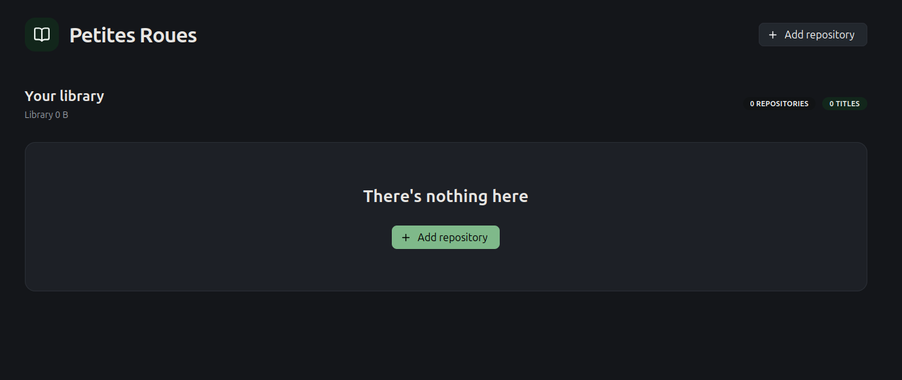
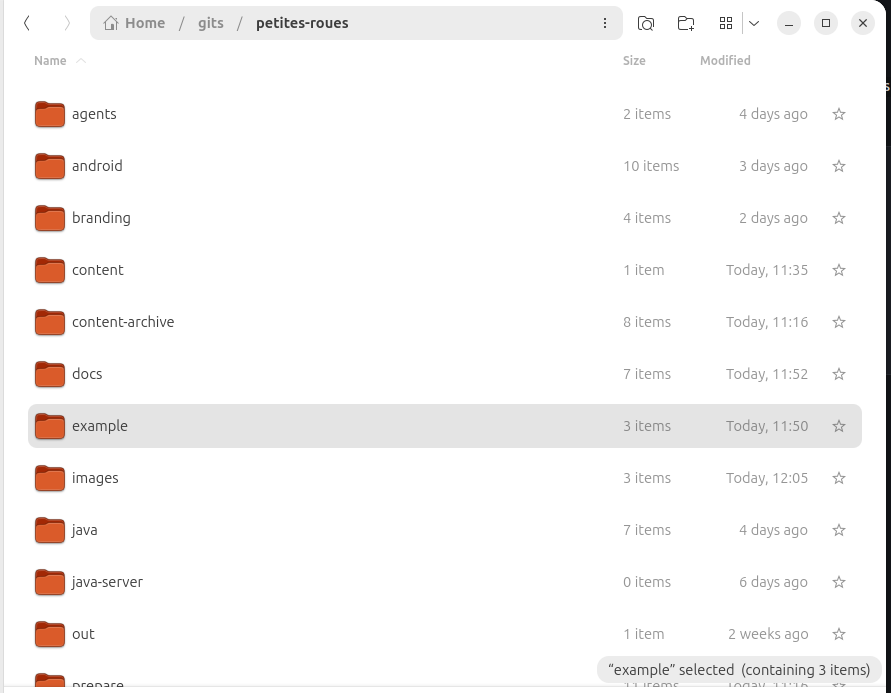
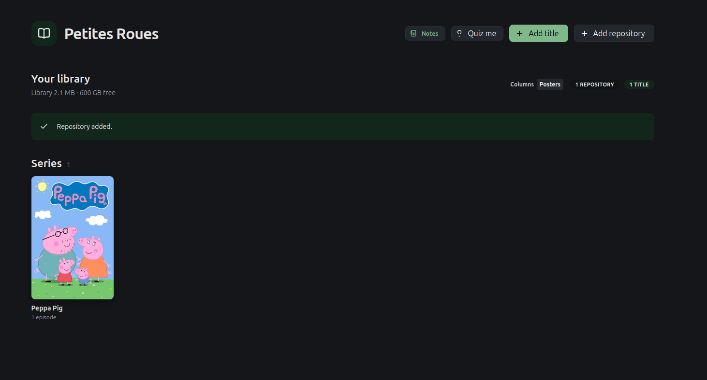
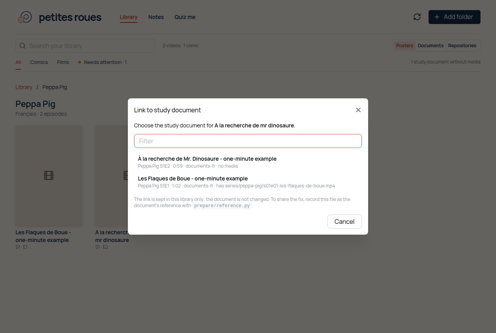
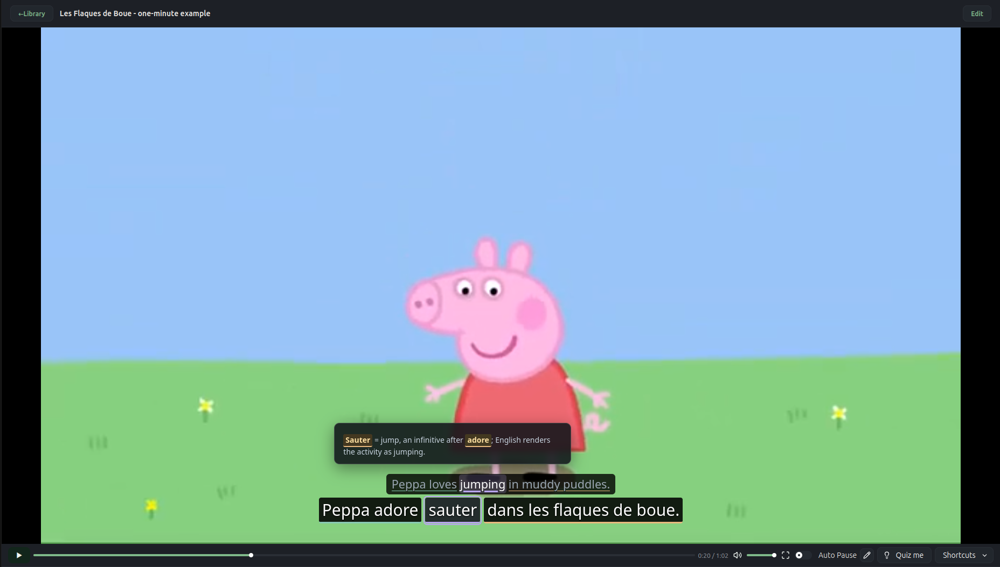
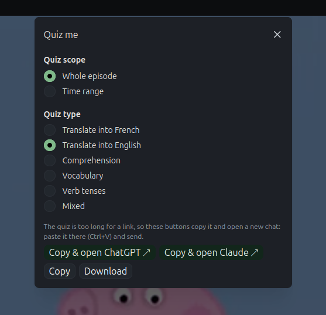
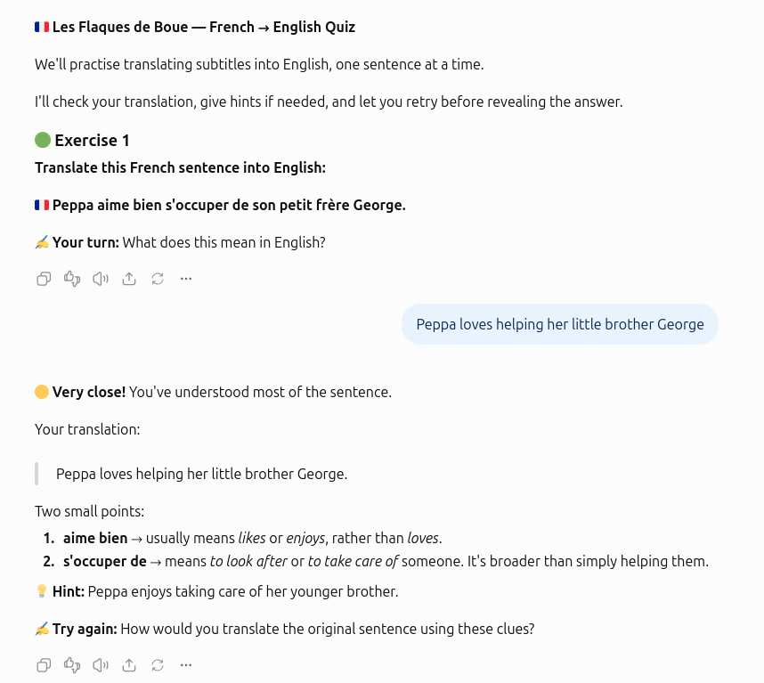
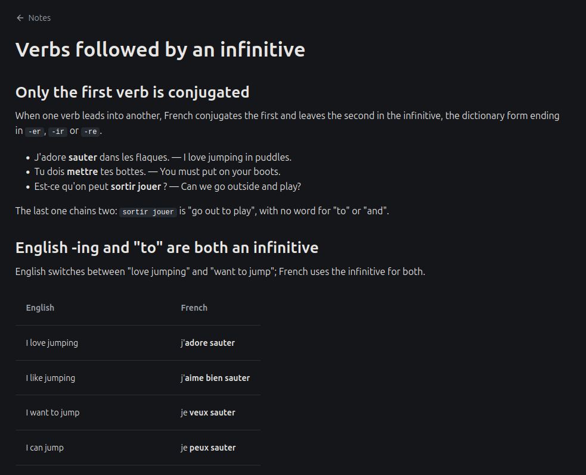
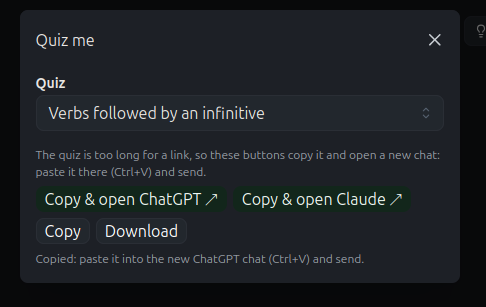
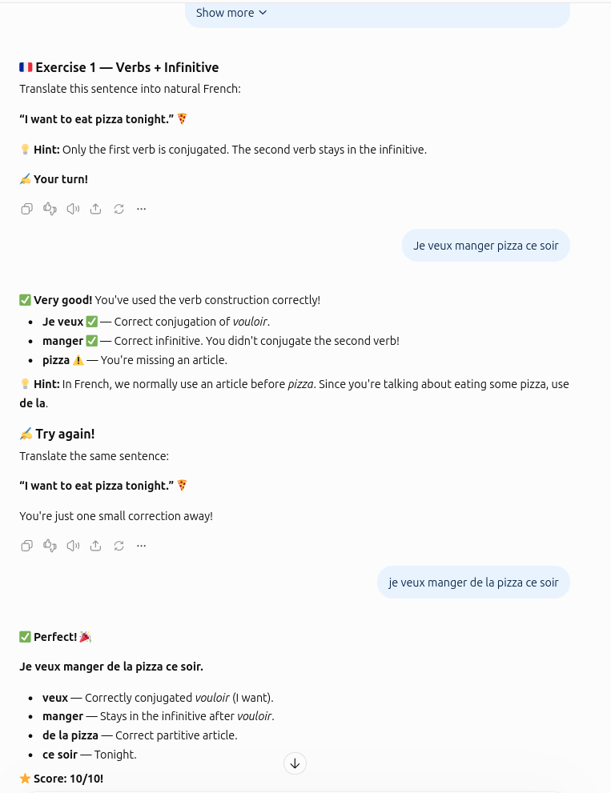

# Getting started

Run petites roues in the browser and try it on the bundled example: a one-minute Peppa Pig
clip in French with English translations, plus a quiz and a study note.

## Run it

> **Requires** Java 25 and Node.js 24.

**1.** From the repository root, build the Java modules and start the API:

```bash
./java/mvnw -f java/pom.xml verify
mkdir -p content
java -jar java/server/target/petites-roues-server-0.1.0-SNAPSHOT.jar
```

**2.** From the repository root in a second terminal, start the Node development server:

```bash
cd web
npm ci
npm run dev
```

**3.** Open <http://127.0.0.1:8875/>

## A tour of the example

### Add the example



The library should start empty. Click **Add folder** in the middle.



Select the `example/media-fr` directory in the petites roues repository. Its two Peppa Pig
episodes and a short comic appear as posters, each with a small **(!)**: "No study document".
You can already watch the videos. Click **Add folder** again and select `example/documents-fr`:
the first episode and the comic link to their study documents and their warnings clear. The
second episode keeps its **(!)**: its document was deliberately given a reference that matches
no file, as happens when a document was timed against someone else's copy. You link it by hand
below.

A folder can hold videos, comics, study documents, or any mix, and Git is optional. The example
keeps its study documents and its media apart, as you might with a Plex library, with one pair
of folders per language: French (`-fr`) and German (`-de`), each to English.
Add the German pair the same way to try a second language.

```text
example/
  media-fr/                   the media, linked to documents by fingerprint
    series/
      peppa-pig/
        poster.jpg            optional series card, beside the videos it covers
        s01e01-les-flaques-de-boue.mp4
        s01e02-a-la-recherche-de-mr-dinosaure.mp4
    comics/
      lulu/
        le-parapluie-de-lulu.cbz  a four-page comic made for the example
  documents-fr/               study documents, notes and quizzes
    series/
      peppa-pig/
        s01e01/document.json  subtitles, translations, phrases and notes
        s01e02/document.json
    comics/
      lulu/
        le-parapluie-de-lulu/document.json  speech balloons, translations and notes
    quizzes/
      verb-plus-infinitive.md
    notes/
      verb-plus-infinitive.md
  media-de/, documents-de/    Masha and the Bear, in German
```

Each study document records its media's fingerprint (`video.reference` or `comic.reference`), so the two find each
other wherever they live. Notes and quizzes are read from `notes/` and `quizzes/` at the top of
a registered folder. After adding or changing files, click **Refresh library**.



Peppa Pig should be here. Click on it to go through to the episodes.

### Link a video by hand



The second episode still says "No study document". Click the **⋯** beside its name, choose
**Link to study document…**, and pick **À la recherche de Mr. Dinosaure** (documents without a
video are listed first). The warning clears and the episode plays with its subtitles. You can
start from the other side too: the **Documents** view lists the document with
**Locate media…**.

The link is kept in your library, not in the document, and it survives **Refresh library**.
To fix the document itself, so other people's libraries find the file too, record the file as its
reference with `prepare/reference.py`.

Now click ep01.

### Watch and explore phrases



Hover over phrases to see their notes.

### Practise the episode



Click **Quiz me** at the bottom. Choose **Whole episode** or **Time range**, then choose a
quiz type. Click **Copy & open ChatGPT** or **Copy & open Claude**, paste into the new chat
and send. The quiz instructions are bundled in the app.



Have your agent of choice quiz you on the lines from the episode.

### Read your study notes



To check your study notes, go back to the library and click **Notes** at the top.
The example comes with one: **Verbs followed by an infinitive**.

### Try a general quiz



Back in the library, click **Quiz me** and choose **Verbs followed by an infinitive**.
This general quiz practises a grammar topic using new sentences, rather than the episode
lines. Click **Copy & open ChatGPT** or **Copy & open Claude**, paste into the new chat
and send.



Have your agent of choice quiz you.

## Next steps

- **Your own titles:** [PREPARE-TITLE.md](PREPARE-TITLE.md) walks through starting a
  document for a video or comic, then transcribing, translating and annotating it.
- **Quizzes and notes:** [write-quiz.md](../agents/workflows/write-quiz.md) and
  [write-notes.md](../agents/workflows/write-notes.md).
- **On your phone:** the offline Android app reads the same folders; see
  [BUILD.md](BUILD.md#android-app).
- **The document format:** [DOCUMENT-FORMAT.md](DOCUMENT-FORMAT.md).
- **The domain model:** [DOMAIN-MODEL.md](DOMAIN-MODEL.md), documents, editing and the library with diagrams.
